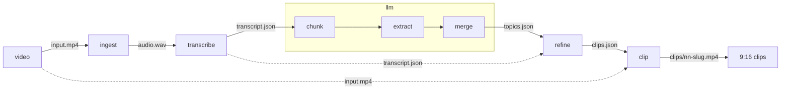

# Echo

Echo takes a long video, finds the best moments, cuts them into short vertical clips (60 seconds max), and posts them to **TikTok, YouTube Shorts, Instagram Reels and Facebook Reels** automatically.

> **Status:** V0 in progress. Done: data contracts, every pipeline stage (audio extraction, transcription, topic extraction with a local or hosted LLM, clip boundaries, cutting 9:16 clips with ffmpeg). In progress: the orchestrator, the `echo-clips` CLI, the end-to-end test and this README (#12–#15). Publishing comes later. The stack below can still change.

---

## How it works

```
 ┌────────────┐   ┌──────────────┐   ┌──────────────┐   ┌────────────┐   ┌──────────────┐
 │  1. Ingest │──▶│ 2. Transcribe│──▶│ 3. Find the  │──▶│ 4. Render  │──▶│  5. Publish  │
 │   video    │   │  + analyze   │   │   moments    │   │   clips    │   │  to platforms│
 └────────────┘   └──────────────┘   └──────────────┘   └────────────┘   └──────────────┘
```

1. **Ingest:** accept a local file or a URL, then normalize it (codec, frame rate, audio).
2. **Transcribe and analyze:** speech-to-text with word-level timestamps, plus signals such as scene changes, audio energy and silence.
3. **Find the moments:** score candidate segments (hooks, punchlines, complete thoughts) and pick the top N. Every clip is **≤ 60 s** and starts and ends on sentence boundaries.
4. **Render clips:**
   - reframe to 9:16 vertical, keeping the speaker or subject centered
   - burn in captions
   - optionally add a title, branding or an outro
5. **Publish:** generate a title, description and hashtags for each clip, then upload it to each enabled platform, either right away or on a schedule.

### The V0 pipeline

V0 covers steps 1–4 for local files, without captions. Each stage reads the previous stage's artifact from the job directory and writes its own:



- **The LLM returns segment ids, never timestamps.** It sees numbered transcript lines and answers with `start_segment`/`end_segment`; refine turns those into times from the transcript. A model can't invent a timestamp, and every clip starts and ends on a segment boundary.
- **Retries:** an answer that isn't valid JSON or uses ids outside its window is sent back to the LLM with the error, up to `llm.max_retries` (2) times. Provider errors (down, bad key, rate limit) aren't retried: the stage fails with a clear message.
- **Chunking:** long transcripts are split into overlapping windows (3000 tokens, 5 segments of overlap). Topics found in several windows are merged by span overlap.
- **Resumability:** a stage is skipped when its outputs already exist, so re-running a job resumes at the first stage that hasn't finished. `job.json` records each stage's status. The clip stage also re-cuts only the clips whose boundaries or settings changed (`clips/manifest.json`).

---

## Roadmap

**V0: video → vertical topic clips** ([milestone](https://github.com/YassineMessioui/Echo/milestone/1))
- [x] Data contracts and per-run job directory (#3)
- [x] Audio extraction with ffmpeg (#4)
- [x] Transcription with faster-whisper and word timestamps (#5)
- [x] Topic extraction with an LLM, local (Ollama) or hosted (Groq, Gemini, …): chunking, extraction, merging (#6–#9); see [docs/llm-providers.md](docs/llm-providers.md)
- [x] Boundary refinement. Clips are **15–60 s** and **never longer than 60 s** (#10)
- [x] Clipping with ffmpeg (#11), output **vertical 9:16 at 1080×1920** by centre crop (#26)
- [ ] Resumable orchestrator and the `echo-clips run` CLI (#12, #13), in progress
- [ ] End-to-end test and full README (#14, #15), in progress

**Later**
- [ ] Smart reframing that follows the speaker (#16)
- [ ] Burned-in captions (#17): caption tracks are built (`captions.py`), not yet burned into clips
- [ ] Clip scoring: keep only the most engaging moments (#21)
- [ ] Speaker diarization (#22)
- [ ] Web UI, job queue, S3 storage (#19, #20, #23)
- [ ] Publishing to YouTube Shorts, TikTok, Instagram Reels and Facebook Reels, with titles, hashtags, a review step and scheduling (_no issues yet_)

---

## Proposed stack

| Layer            | Choice (proposed)                                   |
|------------------|-----------------------------------------------------|
| Language         | Python 3.12, managed with [uv](https://docs.astral.sh/uv/) |
| Lint / tests     | ruff + pytest, run in GitHub Actions CI             |
| Video processing | FFmpeg binaries called through `subprocess` (`echo.ffmpeg`) |
| Transcription    | faster-whisper (local), word-level timestamps       |
| Moment selection | An LLM behind a swappable `LLMClient`: local through [Ollama](https://ollama.com) or hosted through any OpenAI-compatible API (Groq by default for hosted). It returns segment IDs, never timestamps |
| Reframing        | Centre crop to 9:16 for now (position set by `--crop-x`; near-square sources are padded); speaker tracking with MediaPipe / OpenCV later (#16) |
| Captions         | ASS subtitles burned in with FFmpeg                 |
| Queue / jobs     | Start synchronous; move to Celery/RQ + Redis later  |
| Storage          | Local disk first; S3-compatible later (needed for IG/FB, which pull video from a URL) |
| Config           | CLI options → `PipelineConfig` (`echo.config`); API keys from environment variables; a config file later |

---

## Project layout

One module per pipeline stage. Each implements an interface from `echo.interfaces` and
reads/writes artifacts only through `echo.job.Job`; see [docs/contracts.md](docs/contracts.md).

```
Echo/
├── src/echo/
│   ├── models.py, interfaces.py, job.py, config.py, errors.py   # contracts (#3)
│   ├── testing.py       # fakes for tests (FakeLLMClient, FakeTranscriber)
│   ├── ffmpeg.py        # ffmpeg/ffprobe subprocess helpers
│   ├── ingest.py        # input.mp4 → audio.wav (#4)
│   ├── transcribe.py    # audio.wav → transcript.json (#5)
│   ├── llm/             # transcript.json → topics.json
│   │   ├── chunking.py  #   overlapping windows (#6)
│   │   ├── client.py, hosted.py  #   Ollama + hosted LLM clients (#7)
│   │   ├── prompts.py, topics.py   #   topic extraction (#8)
│   │   └── merge.py     #   merge across windows + LLM stage (#9)
│   ├── refine.py        # topics → clips.json, 15–60 s (#10)
│   ├── clip.py, reframe.py  # clips/<nn>-<slug>.mp4, 9:16 (#11, #26)
│   ├── captions.py      # caption tracks (#17, not wired in yet)
│   ├── pipeline.py      # orchestrator (#12, in progress)
│   └── cli.py           # echo-clips (#13, in progress)
├── tests/               # incl. golden fixtures in tests/fixtures/golden/
├── docs/
│   ├── cli.md           # echo-clips options
│   ├── contracts.md     # layer contracts
│   └── llm-providers.md # choosing a local or hosted LLM
├── .github/workflows/   # CI (lint, test on Linux + Windows, build) + release
├── pyproject.toml
└── README.md
```

Later (not V0): `publish/` with one module per platform.

---

## Platform notes

Every platform needs its own developer app and OAuth credentials. Check each one early, because approval can take weeks.

| Platform          | API                              | Notes / gotchas |
|-------------------|----------------------------------|-----------------|
| YouTube Shorts    | YouTube Data API v3 (`videos.insert`) | Vertical video counts as a Short. The default daily quota is limited, and an unverified app may have uploads locked to private. |
| TikTok            | Content Posting API              | Requires an app review. Until the app passes an audit, posts are restricted (e.g. private only). |
| Instagram Reels   | Instagram Graph API              | Needs a Business or Creator account linked to a Facebook Page. Video must be at a **public URL**. |
| Facebook Reels    | Facebook Graph API (Page videos/Reels) | Posts to a Page, not a personal profile. Needs Page permissions through app review. |

> Verify the current limits and requirements on each platform's developer docs before building. They change often.

---

## Getting started

### Prerequisites

- **Python 3.12** and [uv](https://docs.astral.sh/uv/getting-started/installation/) (uv can install Python for you).
- **ffmpeg** and `ffprobe` on your PATH, built **with libass** for burned-in captions: `sudo apt install ffmpeg` (Debian/Ubuntu) and `choco install ffmpeg` (Windows) include it. Homebrew's default `ffmpeg` (macOS) does not: use a build with libass, or turn captions off (`--no-captions` / `caption.enabled = false`).
- **An LLM** for topic extraction. The default is local [Ollama](https://ollama.com):
  ```bash
  ollama pull llama3.2:3b
  ```
  Or a hosted provider (Groq, Gemini, OpenRouter, …) with an API key in the environment; see [docs/llm-providers.md](docs/llm-providers.md). Tests don't need either.

The Whisper model (`small` by default) downloads on the first run.

**Optional: NVIDIA GPU.** Transcription uses the GPU when one is present and its CUDA libraries load; otherwise it runs on the CPU (with one warning line). faster-whisper needs **cuBLAS for CUDA 12** and **cuDNN 9**:
- **Linux:** `uv pip install nvidia-cublas-cu12 "nvidia-cudnn-cu12==9.*"`, then put their `lib` folders on `LD_LIBRARY_PATH`:
  ```bash
  export LD_LIBRARY_PATH=$(.venv/bin/python -c 'import os, nvidia.cublas.lib, nvidia.cudnn.lib; print(os.path.dirname(nvidia.cublas.lib.__file__) + ":" + os.path.dirname(nvidia.cudnn.lib.__file__))')
  ```
- **Windows:** install the [CUDA Toolkit 12](https://developer.nvidia.com/cuda-downloads) and [cuDNN 9](https://developer.nvidia.com/cudnn-downloads) and make sure their `bin` folders are on `PATH` (`cublas64_12.dll`, `cudnn64_9.dll`).

Silence and music are skipped by voice activity detection (`TranscribeConfig.vad_filter`). On a GPU, `TranscribeConfig.batch_size = 8` decodes several ~30 s chunks at once. On a CPU it is ~2× faster but drops ~3 % of the words; a smaller model run sequentially is a better trade, so batching is off by default (benchmarks in #58). Changing the whisper settings (`model_size`, `language`, `batch_size`, `vad_*`) on an existing job re-transcribes it automatically, and re-runs the later stages; `device` and `compute_type` don't. `job.json` records the mode as `models.whisper_mode` (e.g. `"batched-8, vad"`).

### Setup

```bash
git clone https://github.com/YassineMessioui/Echo.git && cd Echo
uv sync                 # creates .venv and installs deps (incl. dev)
```

### Usage

The CLI is called `echo-clips` because `echo` clashes with the shell builtin:

```bash
uv run echo-clips run episode.mp4                         # → jobs/<job_id>/clips/*.mp4
uv run echo-clips run "https://youtu.be/VIDEO_ID"         # a link: audio downloaded, clips read remotely
uv run echo-clips run episode.mp4 --job-id ep42           # name the job; re-run to resume it
uv run echo-clips run episode.mp4 --job-id ep42 --from-stage refine --max-duration 45
uv run echo-clips run episode.mp4 --job-id ep42 --force   # redo every stage
GROQ_API_KEY=... uv run echo-clips run episode.mp4 --llm-provider groq --llm-model openai/gpt-oss-120b
uv run echo-clips run episode.mp4 --aspect source         # keep the original framing
```

Links (YouTube, Vimeo, …) are downloaded with yt-dlp; YouTube also needs a JavaScript runtime (`deno`, `node` or `bun`) on `PATH`. Only clip videos you have the rights to use (see Open questions). Details in [docs/cli.md](docs/cli.md).

- Clips are **9:16 at 1080×1920** by default. `--aspect source` keeps the source framing; `--crop-x` moves the crop window (0 = left, 1 = right).
- Re-running a job skips the stages that are done. `--force` redoes every stage; `--from-stage <name>` redoes that stage and everything after it (e.g. new duration limits only need `refine` and `clip`).
- Every option and its default: [docs/cli.md](docs/cli.md).

---

## Job directory and data contracts

Each run gets a directory, written only through `echo.job.Job` (atomic writes, validated reads):

```
jobs/<job_id>/
├── input.mp4              # link to (or copy of) the source video
├── audio.wav              # ingest: 16 kHz mono PCM
├── transcript.json        # transcribe
├── topics.json            # llm
├── clips.json             # refine
├── clips/
│   ├── 01-<slug>.mp4      # clip, one per entry in clips.json
│   └── manifest.json      # clip: fingerprints used to skip unchanged clips
└── job.json               # orchestrator: stage status and models used
```

The JSON files are the Pydantic models in [`echo.models`](src/echo/models.py); layer rules are in [docs/contracts.md](docs/contracts.md). Times are in seconds.

**`transcript.json`** (`Transcript`): segment ids run from 0 with no gaps; `language` is detected unless `--language` is set; `probability` may be `null`.

```json
{
  "language": "en",
  "duration": 80.5,
  "segments": [
    {
      "id": 0,
      "start": 0.0,
      "end": 8.5,
      "text": "Welcome back to the show, today we have a lot to cover.",
      "words": [{ "start": 0.0, "end": 0.708, "text": "Welcome", "probability": 0.95 }]
    }
  ]
}
```

**`topics.json`** (`list[Topic]`): inclusive segment spans.

```json
[
  {
    "title": "Sleep and productivity",
    "summary": "How even small sleep losses hurt focus and reaction time.",
    "start_segment": 4,
    "end_segment": 7
  }
]
```

**`clips.json`** (`list[ClipSpec]`): `duration` is `end - start`, rounded to milliseconds.

```json
[{ "topic_title": "Sleep and productivity", "start": 34.0, "end": 80.2, "duration": 46.2 }]
```

**`job.json`** (`JobMeta`): `status` is `pending`, `running`, `done`, `skipped` or `failed`; `error` is set on failure.

```json
{
  "job_id": "ep42",
  "source": "/videos/episode.mp4",
  "created_at": "2026-11-16T12:00:00Z",
  "stages": {
    "ingest": { "status": "done", "started_at": "2026-11-16T12:00:00Z", "finished_at": "2026-11-16T12:00:03Z", "error": null },
    "transcribe": { "status": "done", "started_at": "2026-11-16T12:00:03Z", "finished_at": "2026-11-16T12:01:10Z", "error": null },
    "llm": { "status": "failed", "started_at": "2026-11-16T12:01:10Z", "finished_at": "2026-11-16T12:01:11Z", "error": "..." },
    "refine": { "status": "pending", "started_at": null, "finished_at": null, "error": null },
    "clip": { "status": "pending", "started_at": null, "finished_at": null, "error": null }
  },
  "models": { "whisper": "faster-whisper/small", "whisper_mode": "sequential, vad" }
}
```

**`clips/manifest.json`**: file name → hashes of its `ClipSpec` and `ClipConfig`. A clip is re-cut when either changes; files no longer in `clips.json` are deleted.

```json
{
  "01-sleep-and-productivity.mp4": { "clip": "9c1e4f0a2b7d3e58", "config": "4a7b0c2d9e1f3a65" }
}
```

---

## Development

```bash
uv run ruff check .     # lint
uv run ruff format .    # format (CI runs --check)
uv run pytest           # tests; real-model tests are skipped by default
uv run pytest -m model  # also run the real Whisper model (slow, downloads weights)
```

Tests marked `ffmpeg` use the real binaries and are skipped if ffmpeg isn't installed. Develop against the golden fixtures and fakes described in [docs/contracts.md](docs/contracts.md).

**Pull requests:** every change goes through a PR to `main` from a branch. It can be merged once the required checks pass: `lint`, `test (ubuntu-latest)` and `test (windows-latest)`, with the branch up to date and review conversations resolved. Any collaborator can merge once green; ask the other owner for a review on anything non-trivial. Contract changes (`models.py`, `interfaces.py`, `job.py`, `errors.py`, `config.py`, golden fixtures) get their own PR.

**Releasing:** bump `version` in `pyproject.toml`, then push a tag:

```bash
git tag v0.1.0 && git push origin v0.1.0
```

The release workflow runs the tests, builds the package and publishes a GitHub Release with the wheel and sdist attached.

---

## Configuration

V0 is configured through `echo-clips` options, which map to `PipelineConfig` in [`echo.config`](src/echo/config.py); API keys come only from environment variables. A config file is planned for later (draft):

```yaml
clips:
  max_count: 5
  max_duration_s: 60
  min_duration_s: 15
  aspect: "9:16"
captions:
  enabled: true
  style: bold-center
publish:
  youtube:   { enabled: true,  privacy: private }
  tiktok:    { enabled: false }
  instagram: { enabled: false }
  facebook:  { enabled: false }
  require_approval: true
```

---

## Team

- **Imad Ait Ben Salah** ([Imdbn](https://github.com/Imdbn)): co-owner
- **Yassine Messioui** ([YassineMessioui](https://github.com/YassineMessioui)): co-owner

## Open questions

- Local processing or cloud (GPU for Whisper and face tracking)?
- Who owns the source videos? We need a rights and permissions policy before posting content we didn't create.
- Is this a CLI tool for ourselves, or a SaaS with user accounts?
- Which LLM gives the best topic boundaries? First result: Groq's `openai/gpt-oss-120b` found exactly the right three topics on a 2-minute test podcast. Still to try on real long episodes, and locally with Ollama.

## License

TBD
