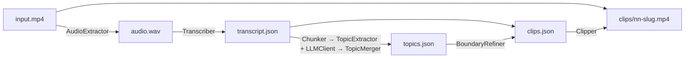

# Layer contracts

Each layer owns one module and implements one interface from
[`echo.interfaces`](../src/echo/interfaces.py). Layers never import each other: they
share only the models in [`echo.models`](../src/echo/models.py), so they can be built
in parallel.

| Issue | Layer | Module | Implements | Input | Output |
|---|---|---|---|---|---|
| #4 | ingest | `echo/ingest.py` | `AudioExtractor` | `input.mp4` (or `input-audio.m4a` for links) | `audio.wav` (16 kHz mono PCM) |
| #5 | transcribe | `echo/transcribe.py` | `Transcriber` | `audio.wav` | `Transcript` → `transcript.json` |
| #6 | llm | `echo/llm/chunking.py` | `Chunker` | `Transcript` | `list[TranscriptWindow]` |
| #7 | llm | `echo/llm/client.py` | `LLMClient` | system + prompt | raw text |
| #8 | llm | `echo/llm/topics.py` | `TopicExtractor` | `TranscriptWindow` | `list[Topic]` (ids inside window) |
| #9 | llm | `echo/llm/merge.py` | `TopicMerger` | `list[list[Topic]]` | `list[Topic]` → `topics.json` |
| #22 | diarize (optional) | `echo/diarize.py` | `Diarizer` | `audio.wav`, `transcript.json` (offset) | `Speakers` → `speakers.json` |
| #10 | refine | `echo/refine.py` | `BoundaryRefiner` | `Transcript`, `list[Topic]` | `list[ClipSpec]` → `clips.json` |
| #11 | clip | `echo/clip.py` | `Clipper` | `input.mp4` (or a `RemoteVideo` for links), `list[ClipSpec]` | `clips/<nn>-<slug>.mp4` |
| #12 | orchestration | `echo/pipeline.py` | `Stage` adapters + runner | `Job` | `job.json` |
| #13 | orchestration | `echo/cli.py` | Typer CLI | args | job directory |
| #101 | post text (command `posts`) | `echo/publish/text.py` | `LLMPostWriter` | `clips.json`, `transcript.json`, `topics.json` | `ClipPost` text → `clips/publish.json` |
| #102 | review (command `review`) | `echo/publish/review.py` | `ready_to_publish` (the publish gate) | `clips/publish.json` | `ClipPost.approval` / edited text → `clips/publish.json` |
| #67 | publish (a command, not a stage) | `echo/publish/` | `Publisher` (one per `Platform`) | `clips/<nn>-<slug>.mp4`, approved `ClipPost`s | `PublishResult` → `clips/publish.json` |

## Rules

- **Read and write artifacts only through `echo.job.Job`.** It knows the paths,
  validates on read and writes atomically. Don't build paths by hand.
- **Raise `echo.errors` exceptions** for expected failures (bad input, missing
  ffmpeg, LLM down). Anything else is treated as a bug.
- **Develop against the golden fixtures.** `tests/fixtures/golden/` holds one
  consistent fake episode (`transcript.json` → `topics.json` → `clips.json`). The
  `golden_job` / `job_copy` pytest fixtures load it. Use `echo.testing.FakeLLMClient`
  and `FakeTranscriber` instead of real models in unit tests.
- **Config:** each layer reads only its own section of `echo.config.PipelineConfig`.
- **Changing a contract** (`models.py`, `interfaces.py`, `job.py`, `errors.py`,
  `config.py`, golden fixtures) needs its own PR, so every layer owner can review
  it. Don't fold contract changes into a feature PR.
- **ffmpeg:** media layers call the binaries only through `echo.ffmpeg` (`ffmpeg()`,
  `probe()`), which turns failures into `ExternalToolError` / `InvalidInputError`
  with the stderr tail. In tests, generate inputs with the `make_video` fixture and
  mark tests that need the real binaries with `@pytest.mark.ffmpeg`.
- **Publishing (#67) never happens in a pipeline run.** Only the separate `publish`
  command posts, only clips whose `ClipPost.approval` is `approved`
  (`PublishConfig.require_approval` can't be turned off; publishers get their posts
  from `echo.publish.review.ready_to_publish`), and at `private` unless
  configured otherwise. Platform credentials live in `.env` / an OAuth token cache,
  never in config or the job directory.
- **Re-running on changed settings:** a stage can define `settings(config) -> str | None`
  (a fingerprint of the config its outputs depend on). The orchestrator records it in
  `job.json` and re-runs the stage, and so the later ones, when it changes.
- **Progress:** call `echo.progress.report(fraction, detail)` inside `Stage.run`. It
  becomes a `RUNNING` `StageEvent` with `progress` / `detail`. Report from the stage's
  own thread, not from worker threads.
