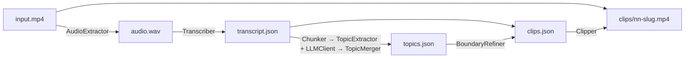

# Layer contracts

Each layer owns one module and implements one interface from
[`echo.interfaces`](../src/echo/interfaces.py). Layers never import each other: they
share only the models in [`echo.models`](../src/echo/models.py), so they can be built
in parallel.

| Issue | Layer | Module | Implements | Input | Output |
|---|---|---|---|---|---|
| #4 | ingest | `echo/ingest.py` | `AudioExtractor` | `input.mp4` | `audio.wav` (16 kHz mono PCM) |
| #5 | transcribe | `echo/transcribe.py` | `Transcriber` | `audio.wav` | `Transcript` → `transcript.json` |
| #6 | llm | `echo/llm/chunking.py` | `Chunker` | `Transcript` | `list[TranscriptWindow]` |
| #7 | llm | `echo/llm/client.py` | `LLMClient` | system + prompt | raw text |
| #8 | llm | `echo/llm/topics.py` | `TopicExtractor` | `TranscriptWindow` | `list[Topic]` (ids inside window) |
| #9 | llm | `echo/llm/merge.py` | `TopicMerger` | `list[list[Topic]]` | `list[Topic]` → `topics.json` |
| #10 | refine | `echo/refine.py` | `BoundaryRefiner` | `Transcript`, `list[Topic]` | `list[ClipSpec]` → `clips.json` |
| #11 | clip | `echo/clip.py` | `Clipper` | `input.mp4`, `list[ClipSpec]` | `clips/<nn>-<slug>.mp4` |
| #12 | orchestration | `echo/pipeline.py` | `Stage` adapters + runner | `Job` | `job.json` |
| #13 | orchestration | `echo/cli.py` | Typer CLI | args | job directory |

## Rules

- **Read and write artifacts only through `echo.job.Job`.** It knows the paths,
  validates on read and writes atomically. Don't build paths by hand.
- **Raise `echo.errors` exceptions** for expected failures (bad input, missing
  ffmpeg, LLM down). Anything else is treated as a bug.
- **Develop against the golden fixtures.** `tests/fixtures/golden/` holds one
  consistent fake episode (`transcript.json` → `topics.json` → `clips.json`). The
  `golden_job` / `job_copy` pytest fixtures load it. Use `echo.testing.FakeLLMClient`
  and `FakeTranscriber` instead of real models in unit tests.
- **Config:** each layer reads only its own section of `echo.config.PipelineConfig`.
- **Changing a contract** (`models.py`, `interfaces.py`, `job.py`, `errors.py`,
  `config.py`, golden fixtures) needs its own PR, so every layer owner can review
  it. Don't fold contract changes into a feature PR.
- **ffmpeg:** media layers call the binaries only through `echo.ffmpeg` (`ffmpeg()`,
  `probe()`), which turns failures into `ExternalToolError` / `InvalidInputError`
  with the stderr tail. In tests, generate inputs with the `make_video` fixture and
  mark tests that need the real binaries with `@pytest.mark.ffmpeg`.
